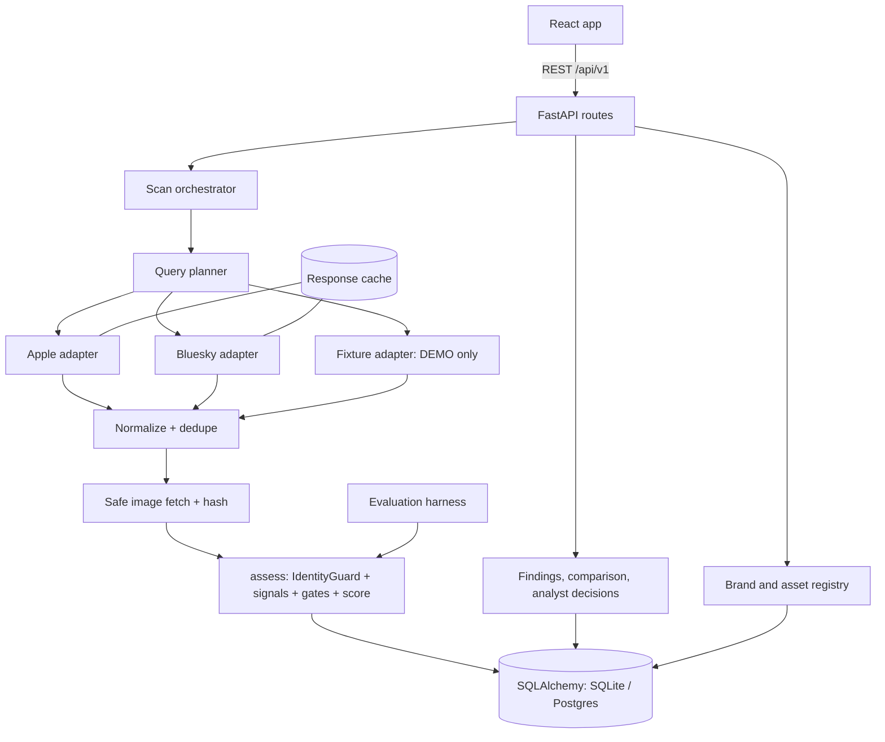
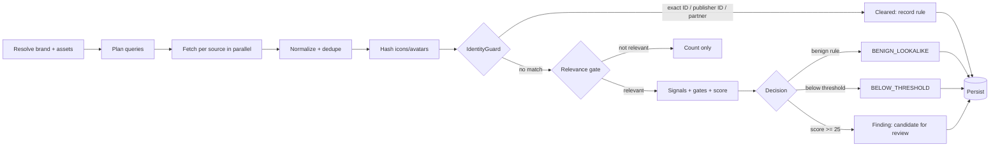

# ThreatLens v3 — Architecture & API Contract

**Hackathon:** HacXLerate 2026 · Challenge 3: Digital Risk Protection — Social & App Monitoring (Kampus.VC)
**Constraint:** 24 hours · 5-person team · each member builds one part with AI tools against this single document
**Contract version:** `3.0.0` · **API prefix:** `/api/v1`
**Supersedes:** ThreatLens v2 and the earlier CloneHunter mock contract (retire both).

> ThreatLens surfaces **candidates for review**, never proven criminals. Official assets are excluded by **exact identity evidence**, never by name similarity. Every result shows its evidence, its source, and its limits. LIVE, CACHED, SIMULATED, NOT_CONNECTED and ERROR states are never silently mixed.

---

## Contents

0. How to use this document
1. Product and rubric traceability
2. Non-negotiable principles
3. Scope (P0 / P1 / out of scope)
4. Tech stack
5. System architecture (diagram, pipeline, modes and labels, query planner, rate limits, security)
6. Domain model and identifiers
7. IdentityGuard specification
8. Scoring specification (normalization, signals, evidence groups, gates, **8.4a G5 safeguards**, worked examples, **8.7 scoring walkthroughs**)
9. Data model
10. Conventions, enums and error-code mapping
11. API contract (health, brands, assets, scans, findings and comparison, evaluation, P1 reserved)
12. Internal Python interfaces
13. Sources and connectors, hour-1 API spike
14. Evaluation specification (dataset, procedure, metric definitions)
15. Frontend specification (screens, rules, **15.3 interface copy guide**)
16. Team ownership, definitions of done, per-person timeline
17. Integration, Git, milestones, environment variables
18. Demo script and acceptance (checklist, must-pass tests)
19. Preamble for every teammate's AI tool
20. Risk register
21. Deployment configuration
- Appendix A: Verified vs to verify
- Appendix B: DEMO fixture composition

---

## 0. How to use this document

1. This file is the single source of truth. Save it as `docs/ARCHITECTURE_API_CONTRACT.md` in the repo.
2. **Freeze it at hour 1.** After the freeze, only *additive* changes are allowed (new optional fields, new endpoints).
3. A change needs: a PR labelled `contract-change`, approval from the Integration Lead (Person 2), a version bump in section 17, and a message to the whole team.
4. The FastAPI app must generate an OpenAPI schema that matches section 11. A test (`test_openapi_matches_contract`) compares the generated paths and enums with a committed snapshot. The frontend generates its TypeScript types from that OpenAPI file (`openapi-typescript`), so types cannot drift.
5. Every AI-tool session starts with the preamble in section 19.
6. Facts marked **[VERIFY]** came from third-party documentation or memory. Confirm them in the hour-1 API spike (section 13.4) and record the result in `docs/SPIKE_RESULTS.md`.

---

## 1. Product and rubric traceability

**What it does.** A brand registers its official apps and social accounts. ThreatLens searches available app-store and social sources for look-alikes, clears official assets by exact identity, scores the rest from independent evidence, and lets an analyst compare each candidate side by side with the official asset and record a decision.

### Rubric → feature → proof

| Rubric (weight) | What judges look for (from the brief) | How ThreatLens delivers it | Shown in demo | Automated test |
|---|---|---|---|---|
| **Social Media Monitoring (30)** | Impersonating profiles, fake pages, scam accounts; similar names, logos, branding; **official accounts not flagged** | Live Bluesky profile search + enrichment; name look-alike, avatar hash, bio/lure terms, link and footprint signals; exact-ID clearing; DEMO-mode simulated platforms clearly badged | Findings queue, Evidence Compare, Cleared view | `test_official_social_never_flagged`, `test_social_lookalike_detected` |
| **App Store Monitoring (30)** | Similar app names, logos, publisher differences, similar descriptions; **official apps not flagged** | Live Apple catalog search; name, publisher-resemblance, icon hash, description similarity, link and footprint signals; exact app ID and developer ID clearing | Findings queue, Evidence Compare, Cleared view | `test_official_app_never_flagged`, `test_app_lookalike_detected` |
| **Brand Profile (15)** | Clear definition of legitimate assets, validation, profile used to guide detection | Asset registry with per-platform identifiers; store-link **prefill**; validation; the registry drives query planning, IdentityGuard and scoring | Brand Profile screen | `test_asset_validation`, `test_prefill_*` |
| **User Experience (15)** | Easy setup, readable detections, **graceful handling of unavailable sources** | Source Coverage panel, per-source scan outcomes, honest partial results, "why flagged / why cleared" text, empty/error/not-connected states | Scan Detail, Sources | `test_provider_failure_is_not_clean_result` |
| **Presentation & Demo (10)** | Working prototype shown clearly | Two-track 3-minute demo (section 18), deployed or rehearsed | Live | Demo rehearsal checklist |
| **Bonus: look-alike names** | Character swaps, added words, spacing — **without over-flagging** | Technique classifier + distinctive-token weighting + benign-lookalike rules + measured false-positive rate | Evaluation Lab | `test_lookalike_techniques`, `test_hard_negatives` |

---

## 2. Non-negotiable principles

1. **Candidates for review.** UI copy never says "fake", "scam" or "malicious" about an unconfirmed candidate. Only an analyst can set `CONFIRMED_SUSPICIOUS`.
2. **Identity by ID, not by name.** Name similarity finds suspects. It never clears anyone.
3. **No silent fallbacks.** A failed provider is a status, not an empty result. Cached or simulated data is always labelled per record.
4. **LIVE scans contain no simulated records.** DEMO scans never call live providers.
5. **Evidence-first.** Every point of risk traces to a stored, observable fact with source and timestamp.
6. **Missing evidence is not evidence.** Unavailable signals score zero and reduce `evidence_coverage`; they do not imply safety or danger.
7. **Deterministic scoring.** No LLM decides identity, scores or verdicts. An LLM, if used, only rewrites existing evidence into plain language, with a template fallback.
8. **Metrics are computed, never typed.** Evaluation numbers come from running the real code on a labelled dataset.
9. **Secrets stay on the backend.** No provider keys in `VITE_*` or committed files.
10. **Scores are not probabilities.** The UI says "risk score", never "% chance".

---

## 3. Scope

### P0 — must work end to end
1. Brand profile and official-asset registry with validation, partner and publisher identity, and store-link prefill.
2. Live Apple App Store search and lookup (iTunes Search API).
3. Live Bluesky **profile** discovery (`searchActors`) and enrichment (`getProfiles`).
4. Query planner, name normalization, look-alike technique classification.
5. IdentityGuard (exact ID, publisher ID, authorized partner).
6. Deterministic multi-signal scoring with gates and per-signal breakdown.
7. Findings queue, finding detail, Evidence Compare, Cleared view.
8. Source states and per-scan source outcomes (LIVE / CACHED / SIMULATED / NOT_CONNECTED / ERROR).
9. Persistence, analyst decisions (with decision memory across scans), audit events.
10. Icon/avatar similarity (perceptual hash) — **P0-lite**, because the brief names logos in both 30% criteria.
11. DEMO mode with fixtures, and the reproducible evaluation harness with hard negatives.
12. Deployed or rehearsed end-to-end demo.

### P1 — only after P0 is demonstrably working
- Benign-lookalike `DECLARED_UNOFFICIAL` rule (fan/parody disclaimers) if not finished in P0.
- Related candidates (same developer ID or seller domain).
- LLM plain-language summary with deterministic fallback.
- JSON evidence report per finding and CSV export.
- Bluesky post search with an app-password (authenticated) mode.
- One extra social connector (Mastodon or YouTube) after checking access and terms.
- Scan history screen, bulk status updates, scan cancel.

### Out of scope
Coverage of all platforms; scraping that bypasses access controls; automated takedowns; malware verdicts; APK dynamic analysis; graph databases; training ML models; domain/CT/WHOIS monitoring (a possible Round 2 extension).

**Cut order if behind:** P1 items → advanced visualisations → Report View → DEMO fixture breadth. **Never cut:** source transparency, IdentityGuard, evidence traceability, Evidence Compare, hard-negative evaluation, integration time.

---

## 4. Tech stack

| Layer | Choice | Notes |
|---|---|---|
| Frontend | React 18, Vite, TypeScript, Tailwind, shadcn/ui, React Router, TanStack Query, Recharts | One typed API client generated from OpenAPI |
| Backend | Python 3.12 (everyone the same), FastAPI, Pydantic v2 | Modular monolith, async |
| HTTP | `httpx` (async) | Timeouts, retries, per-provider rate limiter |
| Matching | RapidFuzz + custom normalization | Deterministic |
| Text similarity | scikit-learn `TfidfVectorizer` (char n-grams 3–5) | Descriptions and bios |
| Image similarity | Pillow + ImageHash (`phash`) | Signal, not proof |
| Domains | `tldextract` in offline mode (bundled suffix list) | Registered-domain comparison |
| Database access | **SQLAlchemy 2.0 only** | SQLite for local/tests, Supabase Postgres for deployment |
| Migrations | SQL schema file + `create_all` for hackathon | Alembic only if time allows |
| Jobs | In-process `asyncio` task + status persisted in DB; frontend polls | No Celery/Redis |
| Optional AI | Gemini (AI Studio key) or Claude API | Summaries only, with fallback |
| Tests | pytest, FastAPI TestClient, `respx` (mock HTTP), Vitest, one Playwright smoke test | Run before every PR |
| Lint | Ruff, ESLint, `tsc --noEmit` | |
| Deploy | Vercel (frontend), Render or Railway (backend), Supabase (Postgres) | Check current free-tier limits; free backends sleep, so warm up before demo |

Avoid heavy ML packages (`torch`, CLIP, sentence-transformers): they can exceed free-host memory and crash the demo.

---

## 5. System architecture

### 5.1 Component diagram



### 5.2 Scan pipeline



**Stages and progress:** `queued` 0 → `resolving_brand` 5 → `planning_queries` 10 → `fetching` 10–55 → `normalizing` 60 → `hashing_images` 70 → `assessing` 70–95 → `persisting` 98 → `completed` 100. Failure: `failed`.

### 5.3 Modes, statuses and labels

| Concept | Values | Meaning |
|---|---|---|
| **Scan mode** | `LIVE`, `DEMO` | `LIVE` calls real providers (cache allowed, labelled). `DEMO` uses only local fixtures. |
| **Record source mode** (per candidate and per source outcome) | `LIVE`, `CACHED`, `SIMULATED` | `LIVE`: fetched in this scan. `CACHED`: served from the response cache; keeps its original `retrieved_at`. `SIMULATED`: fixture invented by the team. |
| **Source status** | `CONNECTED`, `PARTIAL`, `NOT_CONNECTED`, `RATE_LIMITED`, `ERROR` | `PARTIAL` = some queries succeeded and some failed. |
| **Scan status** | `QUEUED`, `RUNNING`, `COMPLETED`, `COMPLETED_WITH_ERRORS`, `FAILED` | `COMPLETED_WITH_ERRORS` = at least one enabled source ended in `PARTIAL`, `RATE_LIMITED` or `ERROR`. `NOT_CONNECTED` sources are **not** errors. |

Rules:
- A `LIVE` scan may contain `LIVE` and `CACHED` records, never `SIMULATED`.
- A `DEMO` scan may contain `SIMULATED` records and `CACHED` records (recorded real responses used as hard negatives), each badged. It never makes network calls to providers.
- Cache: TTL `CACHE_TTL_SECONDS` (default 3600). `force_refresh=true` bypasses it. If a provider fails and `allow_stale_cache=true`, stale cache may be used, the outcome status is `PARTIAL`, and the message states the cache time. Default `allow_stale_cache=false`.
- A failed provider with no usable cache yields **no candidates and a visible error**. It is never shown as "0 results, all clear".

### 5.4 Query planner

Search engines retrieve by term, so queries are about **retrieval recall**; the look-alike detector classifies what comes back.

Inputs: brand name, keywords, official asset display names. Output: a bounded, ordered list of terms (default **8 for Apple, 6 for Bluesky**, hard maximum 12):
1. Base names: `kaveri bank`, `kaveribank`, `kaveri`.
2. Spacing variants: `kaveribank` ⇄ `kaveri bank`.
3. Separator variants: `kaveri-bank`, `kaveri.bank`.
4. Added-word variants from a list: `official`, `support`, `rewards`, `kyc`, `care`, `app`, `mobile`, `loan`.
5. Distinctive-token only: `kaveri`.

Each candidate stores `matched_queries` so the team can measure recall honestly. Queries are deduplicated after normalization.

### 5.5 Rate limits, timeouts, retries

| Provider | Limiter | Timeout | Retry |
|---|---|---|---|
| Apple iTunes | ≤ 1 request per 3 s (Apple documents roughly 20 calls/min) **[VERIFY]** | 8 s | 1 retry on 5xx or timeout; none on 429 |
| Bluesky public | ≤ 1 request per second (conservative) | 8 s | 1 retry on 5xx or timeout; none on 429 |

- Whole-scan hard timeout: `SCAN_TIMEOUT_SECONDS` (default 90). On timeout, completed work is kept and the scan ends `COMPLETED_WITH_ERRORS`.
- Only one running scan per brand; a second `POST /scans` returns `409 SCAN_ALREADY_RUNNING`.
- HTTP mapping: `429 → RATE_LIMITED`, `401/403 → AUTH_REQUIRED`, `5xx → PROVIDER_UNAVAILABLE`, timeout → `TIMEOUT`, unparseable body → `INVALID_RESPONSE`.

### 5.6 Security rules

- `.env` is git-ignored; commit `.env.example` only.
- The backend never fetches a user-supplied URL. For prefill it **parses** the URL against an allowlisted pattern, extracts the ID, and calls the official API itself.
- Image downloads (icons/avatars) only from allowlisted hosts (`*.mzstatic.com`, `cdn.bsky.app` **[VERIFY exact hostnames]**), https only, no redirects to other hosts, 2 MB cap, 5 s timeout, content type `image/*`, Pillow pixel limit set, never executed or served from the backend.
- Validate and cap all inputs (query length ≤ 100, results ≤ 50 per source).
- Never return stack traces, tokens or raw provider payloads. Store raw payloads only in the cache table and never expose them.
- Respect Bluesky self-labels that ask not to be shown to logged-out users: skip those accounts.
- Store only public fields needed for evidence.
- Public demo: apply an in-process request limit and the query limits above. If you add a shared demo token, treat it as public, not as a secret.

---

## 6. Domain model and identifiers

### 6.1 Platforms and stable identifiers

`platform` values are lowercase slugs. All other enums are UPPER_SNAKE (section 10).

| Platform slug | Asset type | Stable identifier (primary) | Secondary identifiers | Developer/publisher ID | Live source |
|---|---|---|---|---|---|
| `apple_app_store` | `IOS_APP` | `trackId` (numeric string) | `bundle_id` | `artistId` | Apple iTunes |
| `google_play` | `ANDROID_APP` | package name | — | developer ID/name if present | Not connected (DEMO fixtures only) |
| `bluesky` | `SOCIAL_ACCOUNT` | DID (`did:plc:…`) | `handle` | — | Bluesky public |
| `instagram`, `x`, `facebook` | `SOCIAL_ACCOUNT` | platform account ID if known, else normalized handle | `handle` | — | Not connected (DEMO fixtures only) |

Handles can change; prefer DIDs and store IDs. Compare identifiers case-insensitively after trimming; do not strip meaningful characters.

### 6.2 Core objects

- **Brand**: name, description, one or more official domains, keywords, distinctive tokens, industry category.
- **OfficialAsset**: a registered asset with `relationship` `OFFICIAL` or `AUTHORIZED_PARTNER`, a verification method, and (for apps) the developer ID used for publisher clearing.
- **CandidateAsset**: an observed external asset, upserted per `(brand, platform, stable_identifier)`. Holds latest observed fields and the analyst's decision (decision memory).
- **Assessment**: the result of evaluating one candidate in one scan (decision, score, breakdown, evidence).
- **Finding**: an assessment whose decision is `CANDIDATE_FOR_REVIEW`. The API exposes it as `/findings`.
- **Cleared item**: an assessment with any other decision. The API exposes it as `/brands/{id}/cleared`.
- **Evidence**: one observed fact with source and timestamp.

---

## 7. IdentityGuard specification

Pure function, no network, no database. Input: candidate, brand, active official assets. Evaluate in order; the first match wins.

| Order | Rule id | Condition | Decision | Notes |
|---|---|---|---|---|
| 1 | `R1_EXACT_ID` | Same `platform` and (`stable_identifier` or a secondary identifier such as `bundle_id`) equals an **active, verified** asset with `relationship=OFFICIAL` | `OFFICIAL_EXACT_MATCH` | Records matched asset ID |
| 2 | `R2_PUBLISHER_ID` | Same `platform` and `developer_id` equals the `developer_id` of an active, verified `OFFICIAL` asset with `trust_publisher=true` | `OFFICIAL_PUBLISHER_MATCH` | Cleared. UI hint: "Published by the registered developer. Consider registering this app." |
| 3 | `R3_PARTNER` | Same as R1 or R2 but against an asset with `relationship=AUTHORIZED_PARTNER` | `AUTHORIZED_PARTNER_MATCH` | Whitelist for resellers, partners |
| 4 | — | No match | continue to relevance gate and scoring | |

Never clear on name, publisher *name*, logo or description alone. An ambiguous case is a candidate for review. Every clearing stores the matched asset ID, rule id and a human-readable explanation, for example: *"Cleared: exact bundle ID match with registered official app `com.kaveribank.mobile`."*

---

## 8. Scoring specification

`scoring_version`: `"3.0.0"`. All thresholds live in `backend/app/core/scoring_config.py` and are returned by `GET /meta`. Thresholds may be tuned **only on the DEV split** of the evaluation dataset, then frozen.

### 8.1 Name normalization

Unicode NFKC normalize, case-fold, trim, collapse whitespace, map separators (`-_.` and similar) to a single space for comparison, and keep the original strings. Map known confusables (for example Cyrillic `і` U+0456) to Latin equivalents for comparison **and** record that a mapping occurred (this is the `HOMOGLYPH` technique).

**Distinctive-token weighting.** Brand tokens are split into *distinctive* (default: every token not in the generic list, or those set in `brand.distinctive_tokens`) and *generic* (`bank`, `banking`, `official`, `app`, `mobile`, `online`, `support`, `care`, `help`, `rewards`, `secure`, `pay`, `money`, `finance`, `india`, `ltd`, `limited`, plus `brand.generic_tokens_extra`). Distinctive tokens weigh 1.0, generic tokens 0.2. `name_similarity` (0–1) is the maximum of (a) RapidFuzz ratio of the normalized full strings and (b) the weighted token score. The reference formula is below. Golden test vectors live in `backend/tests/fixtures/name_vectors.json` (owned by Person 4; at least 40 vectors including the examples in 8.6); the vectors win on any conflict.

**Reference formula (starting point, tune on DEV only).**
1. `ratio_full`: RapidFuzz `ratio` (0–1) on the normalized strings, and again on the same strings with all spaces removed. Keep the higher. This also catches `SPACING`.
2. `token_score`: split both names into normalized tokens. Each brand token `t` has weight `w_t` (1.0 distinctive, 0.2 generic). `m_t` is the best token-to-token RapidFuzz ratio against any candidate token if that ratio is at least 0.80, else 0. A candidate token that matched no brand token is an *extra* token and weighs 0.2.
   `token_score = Σ(w_t × m_t) / (Σ w_t + 0.2 × extra_token_count)`
3. `name_similarity = max(ratio_full, token_score)`, rounded to 2 decimals. For social accounts compute it for the display name and for the handle (strip the domain suffix such as `.bsky.social`) and keep the higher.

Reference values for brand "Kaveri Bank" (distinctive `kaveri`, generic `bank`): "Kaveri Bank" → 1.00; "Kaveri Bank Rewards" → 0.86 (the example in 11.5 shows a rounded 0.85 and is illustrative); "Kaveri Coffee Roasters" → about 0.63 (passes G1, then cleared by G4 in the 8.6 example); "Coffee Roasters" → below 0.60 (fails G1).

**Technique classification** (`LookalikeTechnique`): `EXACT_NAME_REUSE`, `HOMOGLYPH`, `CHARACTER_SWAP` (adjacent transposition), `OMISSION`, `REPETITION`, `KEYBOARD_ADJACENT`, `ADDED_WORD`, `SPACING`, `SEPARATOR`, `NONE`. Return the first matching technique in that order plus the matched official and observed strings.

### 8.2 Signals (points sum to 100 per asset class)

**Apps (`IOS_APP`, `ANDROID_APP`)**

| Signal id | Group | Max | Value `v` (0–1) | Unavailable when |
|---|---|---|---|---|
| `name_lookalike` | NAME | 25 | `clamp((name_similarity − 0.50) / 0.45)` | never |
| `publisher_impersonation` | IDENTITY | 20 | `clamp((sim − 0.50) / 0.40)` where `sim` = best similarity between candidate publisher name and {official publisher names, brand name} | candidate publisher missing |
| `icon_similarity` | VISUAL | 20 | `sim = 1 − hamming(phash)/64`; `v = 1` if `sim ≥ 0.90`, `0` if `sim ≤ 0.70`, linear between | either icon hash missing |
| `description_similarity` | CONTENT | 15 | TF-IDF char-n-gram cosine `c` against official description(s); `v = clamp((c − 0.30) / 0.40)` | candidate or official description missing |
| `link_domain_mismatch` | CONTEXT | 8 | any link (seller URL) registered domain ∈ official domains → `0`; links present and none official → `1` | no link present |
| `lure_terms` | CONTENT | 6 | distinct lexicon hits in name/description: 0 → `0`, 1 → `0.5`, ≥2 → `1` | text missing |
| `thin_footprint` | CONTEXT | 6 | mean of available sub-indicators: released < 90 days ago → 1; rating count < 50 → 1 | all sub-indicators missing |

**Social accounts (`SOCIAL_ACCOUNT`)**

| Signal id | Group | Max | Value `v` (0–1) | Unavailable when |
|---|---|---|---|---|
| `name_lookalike` | NAME | 25 | on display name and handle: use the higher similarity | never |
| `avatar_similarity` | VISUAL | 20 | same mapping as icon similarity | either hash missing |
| `bio_similarity` | CONTENT | 15 | TF-IDF cosine of bio against brand descriptor text (name, description, keywords, official descriptions); same mapping as description | bio missing |
| `link_domain_mismatch` | CONTEXT | 15 | links present, none official → `1`; any official → `0`; **no link** → `0.5` (status `INFERRED`) | — |
| `lure_terms` | CONTENT | 10 | as above, over bio, display name and handle | text missing |
| `thin_footprint` | CONTEXT | 15 | mean of: account age < 90 days → 1; followers < 100 → 0.5; posts < 10 → 0.5 (each normalized to 0 or its value) | all missing |

`points = round(max × v, 1)`. `risk_score = round(sum(points))`, clamped 0–100. Each signal returns a status: `OBSERVED`, `INFERRED`, `UNAVAILABLE` or `SIMULATED` (for fixture-backed records) and a one-sentence `reason`.

**Publisher signals, design note.** A publisher that merely *differs* from the registered developer is the normal state of every third-party app, so a mismatch carries **no points and never counts as evidence**; Evidence Compare shows it as a plain fact. The only publisher signal is `publisher_impersonation`: the candidate's publisher *name* resembles an official publisher name or the brand name (for example `Kaveri Bank Limited` vs the registered `Kaveri Bank Ltd`, or `KaveriBank Services`). It sits in the `IDENTITY` group and corroborates only when it fires (`v ≥ 0.5`) from an `OBSERVED` publisher string. Publisher resemblance never clears anyone: IdentityGuard uses developer **IDs** only (section 7).

**Lexicons** (`backend/app/services/lexicons/`): `lure_terms.json` (English and Hinglish: `kyc`, `update`, `refund`, `reward`, `cashback`, `instant loan`, `verify account`, `customer care`, `helpline`, `otp`, `claim now`, `free gift`, …) and `disclaimer_terms.json` (`unofficial`, `fan page`, `not affiliated`, `parody`, …). Both are plain data files with tests.

### 8.3 Evidence groups

Groups: `NAME`, `IDENTITY`, `VISUAL`, `CONTENT`, `CONTEXT`. A group **fires** when any of its signals has `v ≥ 0.5` and status `OBSERVED`. `corroborating_groups` = fired groups **excluding NAME**. This stops correlated signals from being counted as independent corroboration: description similarity and lure terms both sit in `CONTENT`, so together they count once.

### 8.4 Gates and decisions (evaluated in this order)

| Gate | Condition | Effect |
|---|---|---|
| **G1 Relevance** | `name_similarity < 0.60` | Not relevant: counted in the funnel, not persisted as an assessment |
| **G4 Benign lookalike** | `corroborating_groups == 0` **and** (category mismatch **or** observed description/bio similarity `< 0.20`) | Decision `BENIGN_LOOKALIKE`, rule `G4_UNRELATED_CATEGORY` or `G4_LOW_CONTENT_OVERLAP`; displayed score capped at 24 |
| **G5 Declared unofficial** *(P0 if time, else P1)* | Disclaimer term present **and** `lure_terms v = 0` **and** no mismatching external link **and** every safeguard in 8.4a holds | Decision `BENIGN_LOOKALIKE`, rule `G5_DECLARED_UNOFFICIAL`; UI notes that disclaimers can be abused and an analyst may override |
| **G2 Corroboration** | `len(corroborating_groups) < 2` | Cap score at 49 (maximum severity `MEDIUM`) |
| **G3 Coverage** | `evidence_coverage < 0.50` | Cap score at 49 and add the note "Insufficient evidence" |
| **Threshold** | after caps, `score < 25` | Decision `BELOW_THRESHOLD` (cleared view, rule `BELOW_REVIEW_THRESHOLD`) |
| Otherwise | | Decision `CANDIDATE_FOR_REVIEW` (a finding) |

`category mismatch` (apps): candidate `category` and `brand.industry_category` both present and not equal or synonyms (synonym table in config). Unavailable for social accounts.

`evidence_coverage` = (sum of max points of signals whose status is not `UNAVAILABLE`) / 100.

**Severity bands (after caps):** `LOW` 0–24, `MEDIUM` 25–49, `HIGH` 50–74, `CRITICAL` 75–100.

### 8.4a G5 safeguards (a disclaimer must not become a hiding place)

Impersonators can copy a "fan page" or "unofficial" sentence to buy a free pass. G5 applies **only if every condition holds**; otherwise it is skipped and normal scoring continues.

1. A `disclaimer_terms` phrase appears in the **bio or description**. A disclaimer in the display name or handle alone does not count.
2. `lure_terms v = 0`, and no external link points outside the official domains (an absent link is acceptable).
3. **No `VISUAL` or `IDENTITY` group fired.** A copied icon/avatar or an imitated publisher name cancels the exemption, because a genuine fan page has no reason to reuse the official logo.
4. The technique is not `EXACT_NAME_REUSE` or `HOMOGLYPH`. Reusing the exact name or hiding characters is intent evidence, not parody.

When G5 applies: the displayed score is capped at 24 (as for G4); the item appears in Cleared with the badge "Declared unofficial, not verified"; the matched phrase is stored as evidence (`evidence_type=DISCLAIMER_TEXT`); and the UI states that disclaimers can be copied by impersonators and an analyst may override.

- **Re-evaluated every scan.** `content_hash` already covers description/bio, so removing the disclaimer, or adding a logo copy or lure terms later, brings the item back as a finding with `changed_since_decision=true`.
- **Analyst override:** P1 endpoint `POST /brands/{brand_id}/cleared/{assessment_id}/reopen` (reserved in 11.7).
- **Evaluation:** at least 4 adversarial `IMPERSONATION` cases that carry a disclaimer (with copied avatar; with lure terms; with exact name; disclaimer only in the display name). Report G5-abuse recall separately. See tests in 18.3.

### 8.5 One entry point

Person 4 exposes a single pure function used by the orchestrator **and** the evaluation harness (section 12):

```python
def assess(candidate: NormalizedCandidate, brand: BrandCtx, official_assets: list[OfficialAssetCtx], config: ScoringConfig) -> AssessmentResult
```

No network, no database, deterministic.

### 8.6 Worked examples (use as tests)

| Case | Expected |
|---|---|
| Candidate bundle ID equals the registered official bundle ID | `OFFICIAL_EXACT_MATCH`, never a finding |
| Another app by the registered developer ID | `OFFICIAL_PUBLISHER_MATCH` |
| "Kaveri Coffee Roasters" (Food & Drink) by an unrelated publisher, brand "Kaveri Bank" (Finance) | passes G1; no corroborating groups; category mismatch → `BENIGN_LOOKALIKE` |
| "Kaveri Bank Rewards", different developer, same icon, copied description, new release, lure terms, non-official seller URL | `CANDIDATE_FOR_REVIEW`, `HIGH` (about 72), 3 corroborating groups |
| Exact name "Kaveri Bank" by a different developer with nothing else observable | `CANDIDATE_FOR_REVIEW`, `MEDIUM` (cap 49), coverage note |
| Name `kaveribank` with Cyrillic `і` (U+0456) | technique `HOMOGLYPH` |
| Name "Kaveri  Bank" / "Kav eri Bank" | technique `SPACING` |
| Name "KaveriBnak" | technique `CHARACTER_SWAP` |

---

### 8.7 Scoring walkthroughs (fake app and fan-page scenarios; use as tests)

**Scenario A: fake app.** Brand "Kaveri Bank" (Finance). Candidate "Kaveri Bank Rewards" by a different developer, same icon (phash similarity 0.93), copied description (cosine 0.62), seller link on a non-official domain, released 21 days ago with 12 ratings, lure terms "rewards" and "instant loan".
Points: name 19.5 + publisher 0.0 + icon 20.0 + description 12.0 + link 8.0 + lure 6.0 + footprint 6.0 = 71.5, rounded to **72**. Fired groups: VISUAL, CONTENT, CONTEXT (NAME excluded), so 3 corroborating groups. Coverage 1.0, no gate applies → `CANDIDATE_FOR_REVIEW`, `HIGH`. The full breakdown is in 11.5.

**Scenarios B to E: Bluesky accounts for brand "Kaveri Bank".** Names are all ≈ 0.86 similar, so `name_lookalike` = 20.0 in each. A missing link scores 0.5 with status `INFERRED`, so it never fires a group. Coverage is 1.0 in all four.

| Signal (max) | B Honest fan page | C Fan page that quotes brand text | D Quiet attacker (disclaimer, copied avatar) | E Loud attacker |
|---|---|---|---|---|
| Account | "Kaveri Bank Fans", 400 days old, 2,300 followers, 900 posts | same shape as B | "Kaveri Bank Fans", 9 days old, 25 followers, 4 posts | "Kaveri Bank Care", 12 days old, 40 followers, 3 posts |
| Bio | "Unofficial fan page, not affiliated." | disclaimer plus long quotes from the brand description | "Unofficial fan page, not affiliated." | "unofficial", plus "customer care", "KYC update" |
| `name_lookalike` (25) | 20.0 | 20.0 | 20.0 | 20.0 |
| `avatar_similarity` (20) | 0.0 (sim 0.55) | 0.0 (sim 0.55) | **20.0** (sim 0.95) | **20.0** (sim 0.95) |
| `bio_similarity` (15) | 0.0 (cosine 0.12) | 1.9 (cosine 0.35) | 0.0 (cosine 0.10) | 0.0 (cosine 0.30) |
| `link_domain_mismatch` (15) | 7.5 (no link, `INFERRED`) | 7.5 (no link, `INFERRED`) | 7.5 (no link, `INFERRED`) | **15.0** (shortener link, none official) |
| `lure_terms` (10) | 0.0 | 0.0 | 0.0 | **10.0** (2 hits) |
| `thin_footprint` (15) | 0.0 | 0.0 | **10.0** (mean of 1, 0.5, 0.5 = 0.67) | **10.0** |
| Raw total | 27.5 | 29.4 | 57.5 → 58 | 75 |
| Corroborating groups | none | none | VISUAL, CONTEXT | VISUAL, CONTENT, CONTEXT |
| Gate path | G4 fires: no corroboration and observed bio similarity < 0.20 | G4 does not fire (bio overlap ≥ 0.20); G5 fires (all 4 safeguards hold) | G5 **skipped** (VISUAL fired); G2 not triggered (2 groups) | G5 **skipped** (lure, link, VISUAL) |
| Outcome | `BENIGN_LOOKALIKE`, rule `G4_LOW_CONTENT_OVERLAP`, shown ≤ 24 | `BENIGN_LOOKALIKE`, rule `G5_DECLARED_UNOFFICIAL`, shown ≤ 24, "Declared unofficial, not verified" | `CANDIDATE_FOR_REVIEW`, `HIGH` (58) | `CANDIDATE_FOR_REVIEW`, `CRITICAL` (75) |

Notes. In D, if the attacker's account were old and busy the score would be 47.5 → 48 with one corroborating group, so G2 would cap at 49 and it would still surface as `MEDIUM`; it can never be cleared by the disclaimer. B shows why G4 is evaluated before G5: the recorded rule is the earlier one. All numbers use the reference name formula in 8.1 and are illustrative; real values come from `assess()`.

---

## 9. Data model

SQLAlchemy models, portable types: UUID stored as 36-char string, JSON via SQLAlchemy `JSON`, timestamps UTC. Add indexes on `(brand_id, status)`, `(brand_id, platform)`, `(scan_id)`, `(candidate_asset_id)`.

| Table | Columns |
|---|---|
| `brands` | `id`, `name`, `description`, `official_domains` JSON, `keywords` JSON, `distinctive_tokens` JSON, `generic_tokens_extra` JSON, `industry_category`, `demo_brand` bool, `created_at`, `updated_at` |
| `official_assets` | `id`, `brand_id` FK, `asset_type`, `platform`, `stable_identifier`, `secondary_identifiers` JSON, `developer_id` nullable, `publisher_name` nullable, `display_name`, `handle` nullable, `description` nullable, `canonical_url`, `icon_url` nullable, `icon_hash` nullable, `relationship`, `verification_method`, `is_verified` bool, `trust_publisher` bool, `is_active` bool, `notes`, `created_at`, `updated_at`. **Unique** `(brand_id, platform, stable_identifier)` |
| `scans` | `id`, `brand_id` FK, `mode`, `status`, `stage`, `progress_percent`, `options` JSON, `source_outcomes` JSON, `funnel` JSON, `findings_by_severity` JSON, `events` JSON (capped 200), `error_message`, `created_at`, `started_at`, `completed_at` |
| `candidate_assets` | `id`, `brand_id` FK, `platform`, `asset_type`, `stable_identifier`, `secondary_identifiers` JSON, `display_name`, `handle`, `publisher_name`, `developer_id`, `description`, `category`, `external_links` JSON, `icon_url`, `icon_hash`, `canonical_url`, `created_at_source`, `followers`, `following`, `posts_count`, `rating_count`, `last_source_mode`, `content_hash`, `analyst_status` (default `NEW`), `analyst_reason`, `first_seen_at`, `last_seen_at`, `last_scan_id`. **Unique** `(brand_id, platform, stable_identifier)` |
| `assessments` | `id`, `scan_id` FK, `brand_id` FK, `candidate_asset_id` FK, `identity_decision`, `rule`, `matched_official_asset_id` nullable, `risk_score`, `severity` nullable, `evidence_coverage`, `corroborating_groups` JSON, `gates_applied` JSON, `score_breakdown` JSON, `technique`, `explanation`, `source_mode`, `scoring_version`, `nearest_official_asset_id` nullable, `created_at` |
| `evidence` | `id`, `assessment_id` FK, `candidate_asset_id` FK, `scan_id` FK, `source_id`, `evidence_type`, `status`, `field_name`, `observed_value`, `source_url`, `observed_at`, `notes` |
| `analyst_decisions` | `id`, `candidate_asset_id` FK, `assessment_id` FK nullable, `previous_status`, `new_status`, `decision_reason`, `notes`, `actor_label`, `created_at` |
| `audit_events` | `id`, `brand_id`, `actor_label`, `event_type`, `entity_type`, `entity_id`, `details` JSON, `created_at` |
| `response_cache` | `key` (hash of source + request) PK, `source_id`, `request` JSON, `response` JSON, `retrieved_at`, `ttl_seconds` |
| `evaluation_runs` | `id`, `dataset_id`, `split`, `scoring_version`, `config` JSON, `metrics` JSON, `created_at` |

Datasets live in the repo, not the database: `backend/eval/datasets/<dataset_id>/{brand.json, cases.jsonl, README.md}`.

**Decision memory.** Analyst status lives on `candidate_assets`. A dismissed false positive stays dismissed on later scans, and the default findings queue hides it. If `content_hash` (name, publisher, description, icon hash) changes after the decision, the finding returns with `changed_since_decision=true`.

**Multi-tenancy.** The demo is single-tenant. Do not claim production multi-tenancy. If you use Supabase with a service-role key, keep it backend-only.

---

## 10. Conventions and enums

- JSON, `snake_case`, UUID string IDs, UTC ISO-8601 timestamps (`2026-10-12T05:30:00Z`).
- Lists: `limit` (default 20, max 100) and `offset`; responses `{ "items": [...], "total": 0, "limit": 20, "offset": 0 }`.
- Every response carries header `X-Request-ID`; errors include it.
- Error body:

```json
{"error":{"code":"VALIDATION_ERROR","message":"Invalid fields.","details":[{"field":"stable_identifier","issue":"Must be numeric for apple_app_store"}],"request_id":"<uuid>"}}
```

| Enum | Values |
|---|---|
| `ScanMode` | `LIVE`, `DEMO` |
| `SourceMode` | `LIVE`, `CACHED`, `SIMULATED` |
| `SourceStatus` | `CONNECTED`, `PARTIAL`, `NOT_CONNECTED`, `RATE_LIMITED`, `ERROR` |
| `ScanStatus` | `QUEUED`, `RUNNING`, `COMPLETED`, `COMPLETED_WITH_ERRORS`, `FAILED` |
| `ScanStage` | `queued`, `resolving_brand`, `planning_queries`, `fetching`, `normalizing`, `hashing_images`, `assessing`, `persisting`, `completed`, `failed` |
| `AssetType` | `IOS_APP`, `ANDROID_APP`, `SOCIAL_ACCOUNT` |
| `Relationship` | `OFFICIAL`, `AUTHORIZED_PARTNER` |
| `VerificationMethod` | `OWNER_PROVIDED`, `STORE_LOOKUP`, `DOMAIN_VERIFIED_HANDLE` |
| `IdentityDecision` | `OFFICIAL_EXACT_MATCH`, `OFFICIAL_PUBLISHER_MATCH`, `AUTHORIZED_PARTNER_MATCH`, `BENIGN_LOOKALIKE`, `BELOW_THRESHOLD`, `CANDIDATE_FOR_REVIEW` |
| `Severity` | `LOW`, `MEDIUM`, `HIGH`, `CRITICAL` |
| `FindingStatus` | `NEW`, `IN_REVIEW`, `CONFIRMED_SUSPICIOUS`, `DISMISSED_FALSE_POSITIVE`, `INCONCLUSIVE` |
| `EvidenceStatus` | `OBSERVED`, `INFERRED`, `UNAVAILABLE`, `SIMULATED` |
| `EvidenceGroup` | `NAME`, `IDENTITY`, `VISUAL`, `CONTENT`, `CONTEXT` |
| `LookalikeTechnique` | `EXACT_NAME_REUSE`, `HOMOGLYPH`, `CHARACTER_SWAP`, `OMISSION`, `REPETITION`, `KEYBOARD_ADJACENT`, `ADDED_WORD`, `SPACING`, `SEPARATOR`, `NONE` |
| `ProviderErrorCode` | `TIMEOUT`, `RATE_LIMITED`, `AUTH_REQUIRED`, `PROVIDER_UNAVAILABLE`, `NOT_CONFIGURED`, `INVALID_RESPONSE`, `BLOCKED_URL` |
| `ApiErrorCode` | `VALIDATION_ERROR`, `NOT_FOUND`, `CONFLICT`, `SCAN_ALREADY_RUNNING`, `MODE_NOT_ALLOWED`, `RATE_LIMITED`, `UNAUTHORIZED`, `INTERNAL_ERROR` |
| `EvalLabel` | `IMPERSONATION`, `BENIGN_NAMESAKE`, `OFFICIAL` |
| `EvalProvenance` | `REAL_CAPTURED`, `SYNTHETIC` |
| `EvalSplit` | `DEV`, `HELDOUT` |

**API error code to HTTP status**

| `ApiErrorCode` | HTTP | Notes |
|---|---|---|
| `VALIDATION_ERROR` | 422 | Field-level `details`; also used for a disallowed prefill URL (`details[].issue` includes `BLOCKED_URL`). Malformed JSON → 400 with the same code |
| `NOT_FOUND` | 404 | Unknown brand, asset, scan, finding or evaluation id |
| `CONFLICT` | 409 | Duplicate `(brand_id, platform, stable_identifier)` |
| `SCAN_ALREADY_RUNNING` | 409 | One running scan per brand |
| `MODE_NOT_ALLOWED` | 422 | For example `mode=LIVE` with `demo_fixtures` |
| `RATE_LIMITED` | 429 | Our own demo limiter; send `Retry-After`. Not the same as a provider's `RATE_LIMITED` in a source outcome |
| `UNAUTHORIZED` | 401 | Only if a demo token is enabled |
| `INTERNAL_ERROR` | 500 | Generic message, `request_id` only, no stack trace |

`ProviderErrorCode` values appear only inside `source_outcomes` and prefill responses, never as the HTTP status of our own API (a provider failure during a scan still returns `200` on `GET /scans/{id}`).

Source IDs (fixed list): `apple_itunes`, `bluesky_public`, `bluesky_posts` (optional, authenticated), `google_play_snapshot`, `instagram`, `x`, `facebook`, `demo_fixtures`, `recorded_fixtures`.

---

## 11. API contract

All paths below are prefixed `/api/v1`. `<uuid>` marks a UUID string. Example values are illustrative unless stated.

### 11.1 Health and meta

| Method | Path | Returns |
|---|---|---|
| GET | `/health` | `{"status":"ok","service":"threatlens-api","version":"3.0.0","contract_version":"3.0.0"}` |
| GET | `/ready` | `{"ready":true,"checks":{"database":"ok","config":"ok"}}` (no secrets) |
| GET | `/meta` | Enum values, `scoring_version`, thresholds (`relevance 0.60`, `review 25`, `severity bands`), signal tables, supported platforms and asset types |
| GET | `/sources/status?refresh=false` | Array of source entries (below). `refresh=true` performs a live health check, rate limited |

```json
{"source_id":"apple_itunes","display_name":"Apple App Store search","platform":"apple_app_store","asset_types":["IOS_APP"],"status":"CONNECTED","supported_modes":["LIVE","CACHED"],"default_mode":"LIVE","last_checked_at":"2026-10-12T05:30:00Z","rate_limit_note":"About 20 requests per minute","message":"Live catalog search available."}
```

Required entries and expected states: `apple_itunes` (CONNECTED), `bluesky_public` (CONNECTED), `bluesky_posts` (NOT_CONNECTED), `google_play_snapshot` (NOT_CONNECTED, message "No official API; not queried"), `instagram`, `x`, `facebook` (NOT_CONNECTED, "Requires platform API access"), `demo_fixtures` and `recorded_fixtures` (supported mode `SIMULATED` / `CACHED`, available only in `DEMO` scans). Status reflects the last real outcome, never a guess.

### 11.2 Brands

| Method | Path | Notes |
|---|---|---|
| POST | `/brands` | `201` |
| GET | `/brands?limit&offset` | list |
| GET | `/brands/{brand_id}` | details and counts |
| PATCH | `/brands/{brand_id}` | permitted fields only |
| GET | `/brands/{brand_id}/summary` | overview aggregates (below) |

Create body:

```json
{"name":"Kaveri Bank","description":"Fictional demo brand","official_domains":["kaveribank.example"],"keywords":["Kaveri Bank","KaveriBank"],"distinctive_tokens":["kaveri"],"industry_category":"Finance","demo_brand":true}
```

Validation: name 2–60 chars; domains must be valid hostnames (no scheme, no path); keywords ≤ 12; `demo_brand=true` brands are labelled everywhere in the UI.

Summary response:

```json
{
  "brand_id":"<uuid>",
  "official_asset_count":3,
  "last_scan":{"id":"<uuid>","mode":"LIVE","status":"COMPLETED_WITH_ERRORS","completed_at":"2026-10-12T05:31:10Z"},
  "funnel":{"retrieved":53,"deduplicated":49,"official_cleared":2,"not_relevant":31,"benign_lookalike":7,"below_threshold":3,"findings":6},
  "findings_by_severity":{"LOW":0,"MEDIUM":3,"HIGH":2,"CRITICAL":1},
  "findings_by_status":{"NEW":5,"IN_REVIEW":1,"CONFIRMED_SUSPICIOUS":0,"DISMISSED_FALSE_POSITIVE":0,"INCONCLUSIVE":0},
  "findings_by_platform":{"apple_app_store":4,"bluesky":2},
  "cleared_by_decision":{"OFFICIAL_EXACT_MATCH":1,"OFFICIAL_PUBLISHER_MATCH":1,"AUTHORIZED_PARTNER_MATCH":0,"BENIGN_LOOKALIKE":7,"BELOW_THRESHOLD":3},
  "review_progress":{"reviewed":1,"total":6},
  "source_coverage":[{"source_id":"apple_itunes","status":"CONNECTED","source_mode":"LIVE","retrieved_at":"2026-10-12T05:30:35Z"}],
  "latest_evaluation":{"id":"<uuid>","split":"HELDOUT","precision":null,"recall":null,"created_at":null}
}
```

### 11.3 Official assets

| Method | Path | Notes |
|---|---|---|
| POST | `/brands/{brand_id}/assets/prefill` | Draft from a store link or identifier. Does not persist |
| POST | `/brands/{brand_id}/assets` | register, `201` |
| GET | `/brands/{brand_id}/assets?asset_type&relationship&is_verified&is_active` | list |
| GET | `/brands/{brand_id}/assets/{asset_id}` | one |
| PATCH | `/brands/{brand_id}/assets/{asset_id}` | update or deactivate; write an audit event |

Prefill request (one of):

```json
{"url":"https://apps.apple.com/in/app/kaveri-bank/id1234567890"}
```
```json
{"platform":"bluesky","identifier":"kaveribank.example"}
```

Allowed URL patterns: `apps.apple.com/<cc>/app/<slug>/id<digits>` and `bsky.app/profile/<handle-or-did>`. Anything else returns `422 VALIDATION_ERROR` (code `BLOCKED_URL` in details). The server extracts the ID and calls the official lookup; it never fetches the user's URL.

Prefill response (a draft the user can edit):

```json
{
  "source_id":"apple_itunes","source_mode":"LIVE","retrieved_at":"2026-10-12T05:20:00Z",
  "draft":{"asset_type":"IOS_APP","platform":"apple_app_store","stable_identifier":"1234567890","secondary_identifiers":{"bundle_id":"com.kaveribank.mobile"},"developer_id":"9000000001","publisher_name":"Kaveri Bank Ltd","display_name":"Kaveri Bank","description":"…","category":"Finance","canonical_url":"https://apps.apple.com/in/app/kaveri-bank/id1234567890","icon_url":"https://…","verification_method":"STORE_LOOKUP","relationship":"OFFICIAL","trust_publisher":true}
}
```

If the lookup fails, return `200` with `"draft":null` and a `source_status`/`error_code`, so the UI can say what happened and allow manual entry.

Register body (all fields):

```json
{"asset_type":"IOS_APP","platform":"apple_app_store","stable_identifier":"1234567890","secondary_identifiers":{"bundle_id":"com.kaveribank.mobile"},"developer_id":"9000000001","publisher_name":"Kaveri Bank Ltd","display_name":"Kaveri Bank","handle":null,"description":"…","category":"Finance","canonical_url":"https://apps.apple.com/in/app/kaveri-bank/id1234567890","icon_url":"https://…","relationship":"OFFICIAL","verification_method":"STORE_LOOKUP","is_verified":true,"trust_publisher":true,"notes":"Fictional demo asset"}
```

Rules: `(brand_id, platform, stable_identifier)` is unique (`409 CONFLICT`); `stable_identifier` must be numeric for `apple_app_store`, a valid package name for `google_play`, a `did:` string for `bluesky`; the backend computes `icon_hash` after safe download (skipped if unavailable); a warning is returned when an asset's publisher differs from other `OFFICIAL` assets of the same brand. Never auto-set `is_verified=true` from a name match.

### 11.4 Scans

| Method | Path | Notes |
|---|---|---|
| POST | `/scans` | `202` |
| GET | `/scans/{scan_id}` | status, outcomes, funnel, events |
| GET | `/scans?brand_id&limit&offset` | history (newest first) |
| GET | `/scans/{scan_id}/findings` | findings for that scan |
| GET | `/scans/{scan_id}/cleared` | cleared items for that scan |

Start body:

```json
{"brand_id":"<uuid>","mode":"LIVE","asset_types":["IOS_APP","SOCIAL_ACCOUNT"],"source_ids":["apple_itunes","bluesky_public"],"query_limit_per_source":25,"include_icon_similarity":true,"force_refresh":false,"allow_stale_cache":false}
```

`query_limit_per_source` default 25, max 50. `DEMO` mode ignores `source_ids` for live providers and runs fixtures only. `mode=LIVE` with a `demo_fixtures` source returns `422 MODE_NOT_ALLOWED`. Response `202`:

```json
{"id":"<uuid>","brand_id":"<uuid>","mode":"LIVE","status":"QUEUED","stage":"queued","progress_percent":0,"created_at":"2026-10-12T05:30:00Z"}
```

Scan detail (poll about once per second while `RUNNING`):

```json
{
  "id":"<uuid>","brand_id":"<uuid>","mode":"LIVE","status":"COMPLETED_WITH_ERRORS","stage":"completed","progress_percent":100,
  "options":{"asset_types":["IOS_APP","SOCIAL_ACCOUNT"],"source_ids":["apple_itunes","bluesky_public"],"query_limit_per_source":25,"include_icon_similarity":true,"force_refresh":false,"allow_stale_cache":false},
  "source_outcomes":[
    {"source_id":"apple_itunes","status":"CONNECTED","source_mode":"LIVE","queries_planned":8,"queries_executed":8,"candidate_count":41,"cache_hit_count":0,"error_code":null,"message":"8 queries completed.","retrieved_at":"2026-10-12T05:30:35Z","duration_ms":26110},
    {"source_id":"bluesky_public","status":"RATE_LIMITED","source_mode":"LIVE","queries_planned":6,"queries_executed":4,"candidate_count":12,"cache_hit_count":0,"error_code":"RATE_LIMITED","message":"Stopped after 4 of 6 queries; partial results kept.","retrieved_at":"2026-10-12T05:30:40Z","duration_ms":9120},
    {"source_id":"google_play_snapshot","status":"NOT_CONNECTED","source_mode":null,"queries_planned":0,"queries_executed":0,"candidate_count":0,"cache_hit_count":0,"error_code":null,"message":"No official API. Not queried.","retrieved_at":null,"duration_ms":0}
  ],
  "funnel":{"retrieved":53,"deduplicated":49,"official_cleared":2,"not_relevant":31,"benign_lookalike":7,"below_threshold":3,"findings":6},
  "findings_by_severity":{"LOW":0,"MEDIUM":3,"HIGH":2,"CRITICAL":1},
  "events":[{"at":"2026-10-12T05:30:12Z","stage":"fetching","source_id":"apple_itunes","level":"INFO","message":"Query 3 of 8: kaveri bank rewards"}],
  "error_message":null,"created_at":"2026-10-12T05:30:00Z","started_at":"2026-10-12T05:30:01Z","completed_at":"2026-10-12T05:31:10Z"
}
```

**Invariant (tested):** `deduplicated == official_cleared + not_relevant + benign_lookalike + below_threshold + findings`, and `retrieved >= deduplicated`. `NOT_CONNECTED` sources do not make a scan `COMPLETED_WITH_ERRORS`. A source that failed with zero candidates must not be summarized as "no results".

### 11.5 Findings and comparison

| Method | Path | Notes |
|---|---|---|
| GET | `/findings?brand_id&scan_id&status&asset_type&platform&severity&min_score&source_mode&q&latest_only=true&include_dismissed=false&sort=score_desc&limit&offset` | Findings only (decision `CANDIDATE_FOR_REVIEW`). Sort: `score_desc`, `score_asc`, `seen_desc`, `name_asc` |
| GET | `/findings/{finding_id}` | Detail with breakdown and evidence |
| PATCH | `/findings/{finding_id}` | Analyst decision |
| GET | `/findings/{finding_id}/comparison` | Official vs candidate |
| GET | `/findings/{finding_id}/report` | P1: JSON evidence package |
| GET | `/brands/{brand_id}/cleared?decision&scan_id&platform&q&limit&offset` | Cleared items |
| GET | `/brands/{brand_id}/audit?limit&offset` | Audit trail |

`finding_id` is the assessment ID. `latest_only=true` returns the newest assessment per candidate.

List item:

```json
{"id":"<uuid>","brand_id":"<uuid>","scan_id":"<uuid>","candidate":{"platform":"apple_app_store","asset_type":"IOS_APP","stable_identifier":"9876543210","display_name":"Kaveri Bank Rewards","handle":null,"publisher_name":"KB Rewards Studio","icon_url":"https://…","canonical_url":"https://apps.apple.com/app/id9876543210"},"risk_score":72,"severity":"HIGH","evidence_coverage":1.0,"technique":"ADDED_WORD","top_signals":[{"signal":"name_lookalike","points":19.5,"max_points":25,"reason":"Added word 'Rewards' to the official name."},{"signal":"icon_similarity","points":20.0,"max_points":20,"reason":"Icon perceptual hash is 93% similar to the official icon."}],"status":"NEW","source_mode":"LIVE","observed_at":"2026-10-12T05:30:20Z","changed_since_decision":false}
```

Detail (fields beyond the list item):

```json
{
  "candidate":{"…":"all list fields plus","description":"…","category":"Finance","external_links":["https://kb-rewards.example"],"created_at_source":"2026-09-21T00:00:00Z","followers":null,"rating_count":12},
  "identity_guard":{"decision":"CANDIDATE_FOR_REVIEW","rule":"NO_EXACT_OR_PUBLISHER_MATCH","matched_official_asset_id":null,"explanation":"No registered identifier matches. Name similarity does not prove official status."},
  "risk_score":72,"severity":"HIGH","evidence_coverage":1.0,
  "corroborating_groups":["VISUAL","CONTENT","CONTEXT"],"gates_applied":[],
  "score_breakdown":[
    {"signal":"name_lookalike","group":"NAME","value":0.78,"points":19.5,"max_points":25,"status":"OBSERVED","reason":"Added word 'Rewards' to the official name.","detail":{"technique":"ADDED_WORD","similarity":0.85,"official_value":"Kaveri Bank","observed_value":"Kaveri Bank Rewards"}},
    {"signal":"publisher_impersonation","group":"IDENTITY","value":0.0,"points":0.0,"max_points":20,"status":"OBSERVED","reason":"Publisher differs from the registered developer and does not resemble the official publisher name.","detail":{}},
    {"signal":"icon_similarity","group":"VISUAL","value":1.0,"points":20.0,"max_points":20,"status":"OBSERVED","reason":"Icon perceptual hash is 93% similar to the official icon.","detail":{"similarity":0.93,"hamming_distance":4}},
    {"signal":"description_similarity","group":"CONTENT","value":0.8,"points":12.0,"max_points":15,"status":"OBSERVED","reason":"Description text overlaps strongly with the official description.","detail":{"cosine":0.62}},
    {"signal":"link_domain_mismatch","group":"CONTEXT","value":1.0,"points":8.0,"max_points":8,"status":"OBSERVED","reason":"Seller link domain is not a registered official domain.","detail":{"domains":["kb-rewards.example"]}},
    {"signal":"lure_terms","group":"CONTENT","value":1.0,"points":6.0,"max_points":6,"status":"OBSERVED","reason":"Contains lure terms: rewards, instant loan.","detail":{"hits":["rewards","instant loan"]}},
    {"signal":"thin_footprint","group":"CONTEXT","value":1.0,"points":6.0,"max_points":6,"status":"OBSERVED","reason":"Released 21 days ago with 12 ratings.","detail":{}}
  ],
  "evidence":[{"id":"<uuid>","evidence_type":"APP_STORE_METADATA","source_id":"apple_itunes","status":"OBSERVED","observed_at":"2026-10-12T05:30:20Z","field_name":"publisher_name","observed_value":"KB Rewards Studio","source_url":"https://apps.apple.com/app/id9876543210","notes":"Returned by live catalog search."}],
  "explanation":"Candidate for review: similar name with an added word, near-identical icon, overlapping description and a non-official link. Signals observed; not proof of malicious intent.",
  "limitations":["Hash similarity is not proof of copying.","Description similarity is lexical, not semantic."],
  "scoring_version":"3.0.0","source_mode":"LIVE","status":"NEW","decision_history":[],"created_at":"2026-10-12T05:30:21Z"
}
```

Analyst decision (`PATCH /findings/{id}`):

```json
{"status":"DISMISSED_FALSE_POSITIVE","decision_reason":"Unrelated category and publisher; no impersonation evidence.","notes":"Hard-negative case"}
```

`decision_reason` is required for `DISMISSED_FALSE_POSITIVE` and `CONFIRMED_SUSPICIOUS`. The change updates `candidate_assets.analyst_status`, writes `analyst_decisions` and an audit event, and returns the updated finding.

Comparison response:

```json
{
  "finding_id":"<uuid>","nearest_official_asset_id":"<uuid>",
  "official_asset":{"asset_id":"<uuid>","display_name":"Kaveri Bank","stable_identifier":"1234567890","publisher_name":"Kaveri Bank Ltd","developer_id":"9000000001","category":"Finance","icon_url":"https://…","canonical_url":"https://apps.apple.com/in/app/kaveri-bank/id1234567890"},
  "candidate_asset":{"display_name":"Kaveri Bank Rewards","stable_identifier":"9876543210","publisher_name":"KB Rewards Studio","developer_id":"9000000042","category":"Finance","icon_url":"https://…","canonical_url":"https://apps.apple.com/app/id9876543210"},
  "comparisons":[
    {"field":"display_name","official_value":"Kaveri Bank","candidate_value":"Kaveri Bank Rewards","similarity":0.85,"name_diff":[{"text":"Kaveri Bank","changed":false},{"text":" Rewards","changed":true}],"non_ascii_chars":[]},
    {"field":"publisher_name","official_value":"Kaveri Bank Ltd","candidate_value":"KB Rewards Studio","similarity":0.31},
    {"field":"developer_id","official_value":"9000000001","candidate_value":"9000000042","similarity":null},
    {"field":"icon","official_value":null,"candidate_value":null,"similarity":0.93,"detail":{"hamming_distance":4}},
    {"field":"description","official_value":"…","candidate_value":"…","similarity":0.62}
  ],
  "disclaimer":"Similarity indicates a candidate for review, not proof of malicious intent."
}
```

`name_diff` is a character-level diff (changed segments flagged). `non_ascii_chars` lists non-ASCII characters with codepoints, for example `{"char":"і","codepoint":"U+0456","index":4}`.

Cleared item:

```json
{"id":"<uuid>","scan_id":"<uuid>","candidate":{"platform":"apple_app_store","asset_type":"IOS_APP","stable_identifier":"1234567890","display_name":"Kaveri Bank","publisher_name":"Kaveri Bank Ltd","icon_url":"https://…"},"decision":"OFFICIAL_EXACT_MATCH","rule":"R1_EXACT_ID","matched_official_asset_id":"<uuid>","explanation":"Cleared: exact bundle ID match with registered official app com.kaveribank.mobile.","risk_score":null,"source_mode":"LIVE","observed_at":"2026-10-12T05:30:20Z"}
```

### 11.6 Evaluation

| Method | Path | Notes |
|---|---|---|
| GET | `/evaluations/datasets` | datasets with composition |
| POST | `/evaluations/run` | runs the harness offline |
| GET | `/evaluations/{evaluation_id}` | persisted result |
| GET | `/evaluations/latest?dataset_id&split` | latest result |

Run body:

```json
{"dataset_id":"threatlens-v1","split":"HELDOUT","include_baseline":true,"include_ablation":true}
```

Dataset listing item:

```json
{"dataset_id":"threatlens-v1","case_count":120,"by_label":{"IMPERSONATION":40,"BENIGN_NAMESAKE":60,"OFFICIAL":20},"by_provenance":{"REAL_CAPTURED":70,"SYNTHETIC":50},"by_split":{"DEV":72,"HELDOUT":48},"description":"…","limitations":["Positives are synthetic.","Negatives are real captured namesakes labelled by the team."]}
```

Run result (**the numbers below are an illustrative shape only; real values are computed**):

```json
{
  "id":"<uuid>","dataset_id":"threatlens-v1","split":"HELDOUT","scoring_version":"3.0.0","threshold":{"review":25},
  "sample_count":48,"confusion":{"tp":15,"fp":1,"tn":30,"fn":2},
  "precision":0.94,"recall":0.88,"f1":0.91,"false_positive_rate":0.03,
  "confidence_intervals":{"precision":[0.72,0.99],"recall":[0.66,0.97],"false_positive_rate":[0.0,0.17],"method":"wilson_95"},
  "official_flagged_count":0,
  "hard_negatives":{"tested":24,"correctly_cleared":23,"false_positives":1},
  "technique_recall":[{"technique":"HOMOGLYPH","tested":4,"detected":4},{"technique":"ADDED_WORD","tested":6,"detected":6}],
  "baseline":{"name":"name_only_rapidfuzz","tuned_on":"DEV","precision":0.61,"recall":0.94,"false_positive_rate":0.40},
  "ablation":[{"configuration":"FULL","precision":0.94,"recall":0.88},{"configuration":"NO_IDENTITYGUARD","precision":0.0,"recall":0.0,"official_flagged_count":0},{"configuration":"NO_GATES","precision":0.0,"recall":0.0},{"configuration":"NO_ICON","precision":0.0,"recall":0.0},{"configuration":"NO_DESCRIPTION","precision":0.0,"recall":0.0}],
  "failure_cases":[{"case_id":"…","expected":"BENIGN_NAMESAKE","got":"CANDIDATE_FOR_REVIEW","why":"…"}],
  "definitions":"Positive class = IMPERSONATION. Predicted positive = decision CANDIDATE_FOR_REVIEW. OFFICIAL cases count as negatives and any flagged official asset is also reported separately.",
  "limitations":["Positives are synthetic.","Small sample; see confidence intervals."],
  "created_at":"2026-10-12T20:00:00Z"
}
```

The values in `ablation` rows marked `0.0` above are placeholders for the shape. The harness fills every field from real runs. Never ship hard-coded metrics.

### 11.7 P1 endpoints (reserve the paths)

`GET /findings/{id}/related`, `POST /findings/{id}/summary` (LLM summary from stored evidence only; response carries `generated_by: "llm" | "template"`), `POST /findings/bulk-status`, `GET /brands/{id}/export/findings.csv` (spreadsheet-formula-safe), `POST /scans/{id}/cancel`, `POST /brands/{brand_id}/cleared/{assessment_id}/reopen` (analyst override of a G5 or G4 clearing, writes an audit event).

---

## 12. Internal Python interfaces (the contract between teammates)

Pure Pydantic models and function signatures. Owners do not change them without the process in section 0.

```python
# schemas/candidate.py  (owner: Person 2; consumed by 3, 4, 5)
class NormalizedCandidate(BaseModel):
    source_id: str
    platform: str
    asset_type: AssetType
    stable_identifier: str
    secondary_identifiers: dict[str, str] = {}
    display_name: str
    handle: str | None = None
    publisher_name: str | None = None
    developer_id: str | None = None
    description: str | None = None
    category: str | None = None
    external_links: list[str] = []
    icon_url: str | None = None
    icon_hash: str | None = None            # filled by image_fetch before assess()
    canonical_url: str | None = None
    created_at_source: datetime | None = None
    followers: int | None = None
    following: int | None = None
    posts_count: int | None = None
    rating_count: int | None = None
    source_mode: SourceMode
    retrieved_at: datetime
    matched_queries: list[str] = []

class PlannedQuery(BaseModel):
    term: str
    kind: str          # BASE | SPACING | SEPARATOR | ADDED_WORD | DISTINCTIVE
    priority: int

class QueryPlan(BaseModel):
    brand_id: UUID
    queries: list[PlannedQuery]

class SourceResult(BaseModel):
    source_id: str
    status: SourceStatus
    source_mode: SourceMode | None
    retrieved_at: datetime | None
    candidates: list[NormalizedCandidate]
    queries_executed: int
    cache_hit_count: int
    error_code: ProviderErrorCode | None
    message: str
    duration_ms: int
```

```python
# services/sources/base.py  (owner: Person 3)
class SourceAdapter(Protocol):
    source_id: str
    async def health_check(self) -> SourceHealth: ...
    async def search(self, plan: QueryPlan, limit: int, *, force_refresh: bool, allow_stale_cache: bool) -> SourceResult: ...
    async def lookup(self, identifier: str) -> NormalizedCandidate | None: ...   # used by prefill

# services/image_fetch.py  (owner: Person 3)
async def fetch_icon_hash(url: str) -> str | None   # safe fetch + phash, returns hex string or None
```

```python
# services/query_planner.py  (owner: Person 4)
def plan_queries(brand: BrandCtx, assets: list[OfficialAssetCtx], source_id: str, max_queries: int) -> QueryPlan

# services/assess.py  (owner: Person 4) — pure, no network, no DB
class AssessmentResult(BaseModel):
    identity_decision: IdentityDecision
    rule: str
    matched_official_asset_id: UUID | None
    risk_score: int | None
    severity: Severity | None
    evidence_coverage: float | None
    corroborating_groups: list[EvidenceGroup]
    gates_applied: list[str]
    breakdown: list[SignalResult]
    technique: LookalikeTechnique
    nearest_official_asset_id: UUID | None
    explanation: str
    scoring_version: str
    relevant: bool                      # False when G1 failed (not persisted)

def assess(candidate: NormalizedCandidate, brand: BrandCtx,
           official_assets: list[OfficialAssetCtx], config: ScoringConfig) -> AssessmentResult

def icon_similarity(hash_a: str, hash_b: str) -> float
def compare(candidate: NormalizedCandidate, official: OfficialAssetCtx) -> list[FieldComparison]   # for /comparison
```

```python
# repositories/*.py  (owner: Person 5) — protocols with an in-memory implementation first
class BrandRepo(Protocol): ...
class AssetRepo(Protocol): ...
class ScanRepo(Protocol):
    def create(...); def update_progress(...); def append_event(...); def finish(...)
class CandidateRepo(Protocol):
    def upsert(candidate: NormalizedCandidate, brand_id: UUID, scan_id: UUID) -> CandidateRow
class AssessmentRepo(Protocol):
    def save(scan_id: UUID, candidate_id: UUID, result: AssessmentResult, evidence: list[EvidenceRow]) -> UUID
    def list_findings(filters) -> Page[FindingRow]; def list_cleared(filters) -> Page[ClearedRow]
class DecisionRepo(Protocol): ...
class CacheRepo(Protocol):
    def get(key: str, max_age_s: int | None) -> CachedResponse | None; def put(key: str, source_id: str, request: dict, response: dict)
```

Orchestrator (Person 2) per scan: load brand and assets → `plan_queries` → run adapters concurrently with timeouts → normalize and dedupe by `(platform, stable_identifier)` → `fetch_icon_hash` (bounded concurrency 4) → `assess` for each → persist via repositories → update scan outcomes, funnel, events and status.

The **same `assess()`** is called by the evaluation harness, with no network.

---

## 13. Sources and connectors

### 13.1 Apple App Store (`apple_itunes`) — P0, Person 3

- Search: `https://itunes.apple.com/search?term=<term>&entity=software&country=in&limit=<n>`; lookup: `https://itunes.apple.com/lookup?id=<trackId>` or `?bundleId=<bundle>`.
- No key. Documented limit is roughly 20 calls per minute; cache and throttle. **[VERIFY]**
- Map (field names **[VERIFY]** in the spike): `trackId` → `stable_identifier`; `bundleId` → `secondary_identifiers.bundle_id`; `trackName` → `display_name`; `sellerName` → `publisher_name`; `artistId` → `developer_id`; `description`; `primaryGenreName` → `category`; `sellerUrl` → `external_links`; `artworkUrl100` (or larger) → `icon_url`; `releaseDate` → `created_at_source`; `userRatingCount` → `rating_count`; `trackViewUrl` → `canonical_url`.
- The country defaults to `in` (`APPLE_COUNTRY` env). Do not query multiple countries unless time allows.
- Never expose raw payloads.

### 13.2 Bluesky (`bluesky_public`) — P0, Person 3

- Discovery: `app.bsky.actor.searchActors` on the public AppView (`https://public.api.bsky.app/xrpc/…`). Enrichment: `app.bsky.actor.getProfiles` (batch of up to 25 DIDs). **[VERIFY]**
- Map: DID → `stable_identifier`; `handle`; `displayName` → `display_name`; `description` → bio (store in `description`); `avatar` → `icon_url`; `createdAt` → `created_at_source`; `followersCount`, `followsCount`, `postsCount`; links parsed from bio text and any `website` field → `external_links`.
- Skip accounts with self-labels requesting no unauthenticated display.
- Post search (`searchPosts`) is **not P0**: third-party documentation reports that anonymous calls return 403 or reject pagination. **[VERIFY]** If used (P1), call it with an app-password session from the backend only and label the source mode `LIVE (authenticated)` in the message.
- A handle equal to, or a subdomain of, an official domain is recorded as evidence and may be suggested for registration with `verification_method=DOMAIN_VERIFIED_HANDLE`. It is never auto-registered or auto-cleared.

### 13.3 Others

| Source | State | Behaviour |
|---|---|---|
| `google_play_snapshot` | `NOT_CONNECTED` | Not queried in LIVE. DEMO fixtures may include labelled `SIMULATED` Android records |
| `instagram`, `x`, `facebook` | `NOT_CONNECTED` | Same as above |
| `bluesky_posts` | `NOT_CONNECTED` by default | P1 only |
| `demo_fixtures` | DEMO only | `SIMULATED` records |
| `recorded_fixtures` | DEMO only | Real responses captured in the spike, `CACHED` with original `retrieved_at` |

### 13.4 Hour-1 API spike (Person 3, 15 minutes, results in `docs/SPIKE_RESULTS.md`)

For each URL record HTTP status, latency, fields present, and save one real response as a fixture under `backend/tests/fixtures/`:

1. `https://itunes.apple.com/search?term=kaveri+bank&entity=software&country=in&limit=10`
2. `https://itunes.apple.com/lookup?bundleId=<a real bundle id>&country=in`
3. `https://public.api.bsky.app/xrpc/app.bsky.actor.searchActors?q=bank&limit=5` (expect success)
4. `https://public.api.bsky.app/xrpc/app.bsky.feed.searchPosts?q=bank&limit=5` (expect 403; also try `api.bsky.app`)
5. Check the exact hostnames of the icon/avatar images for the image-host allowlist.

If any result contradicts this contract, raise a `contract-change` immediately.

---

## 14. Evaluation specification

**Goal:** honest, reproducible evidence that official assets are not flagged, hard negatives are handled, and look-alike techniques are detected.

**Dataset** (`backend/eval/datasets/threatlens-v1/`): `brand.json` (evaluation brand and official assets), `cases.jsonl`, `README.md`. One case:

```json
{"case_id":"c-0042","label":"BENIGN_NAMESAKE","provenance":"REAL_CAPTURED","split":"DEV","technique":null,"candidate":{"…NormalizedCandidate fields…":"…"},"labeler":"person4","notes":"Real app, unrelated category and publisher."}
```

**Target composition (about 120 cases):**
- `IMPERSONATION` ≈ 40, `SYNTHETIC`, across all techniques, both asset classes, and combinations (name only, name plus icon, and so on), including at least 4 adversarial declared-unofficial cases (section 8.4a).
- `BENIGN_NAMESAKE` ≈ 60, `REAL_CAPTURED` from live Apple and Bluesky results (the spike and early scans), each manually verified as unrelated by two teammates.
- `OFFICIAL` ≈ 20, including second apps by the same developer and authorized partners.
- Split stratified `DEV` 60% and `HELDOUT` 40%.

**Procedure:**
1. Build the dataset from **hour 1** in parallel with development. Person 4 owns it; a second person verifies every real negative.
2. Tune thresholds and weights **only on DEV**. Freeze them (commit and tag) before running HELDOUT.
3. Report HELDOUT as the headline. Report DEV separately.
4. The run calls `assess()` offline. It does not use the network.

**Metrics:** confusion matrix, precision, recall, F1, false-positive rate, per-technique recall, hard-negative correctness, Wilson 95% intervals, `official_flagged_count` (**must be 0**; a non-zero value fails the run and a test), baseline (name-only RapidFuzz tuned on DEV for fairness), and ablations: `FULL`, `NO_IDENTITYGUARD`, `NO_GATES`, `NO_ICON`, `NO_DESCRIPTION`.

**Metric definitions** (computed in `services/evaluation.py`; deterministic, no sampling):

| Metric | Definition |
|---|---|
| Positive class | `label = IMPERSONATION`. `BENIGN_NAMESAKE` and `OFFICIAL` are negatives |
| Predicted positive | `assess()` returns `CANDIDATE_FOR_REVIEW`. Everything else, including `relevant=False` (G1), is predicted negative |
| `tp`, `fp`, `tn`, `fn` | Actual class × predicted class |
| precision | `tp / (tp + fp)`; `null` if the denominator is 0 |
| recall | `tp / (tp + fn)`; `null` if the denominator is 0 |
| f1 | `2·P·R / (P + R)`; `null` if P or R is `null`, or both are 0 |
| false_positive_rate | `fp / (fp + tn)` |
| Wilson 95% interval for `k` of `n` | `p = k/n`, `z = 1.96`; `centre = (p + z²/2n) / (1 + z²/n)`; `half = z·√(p(1−p)/n + z²/4n²) / (1 + z²/n)`; interval `[centre − half, centre + half]`, clamped to 0–1. Precision: k=tp, n=tp+fp. Recall: k=tp, n=tp+fn. FPR: k=fp, n=fp+tn |
| `official_flagged_count` | `OFFICIAL` cases predicted positive. **Must be 0** |
| Hard negatives | `tested` = `BENIGN_NAMESAKE` cases; `correctly_cleared` = those not predicted positive; `false_positives` = `tested − correctly_cleared` |
| Technique recall | per technique, `tested` = `IMPERSONATION` cases with that expected technique; `detected` = those predicted positive; also report `technique_correct` = detected cases where `assess()` returned the same technique |
| Baseline | predicted positive when `name_similarity ≥ t`; `t` chosen on DEV to maximise F1 (ties → higher precision); evaluated on the same HELDOUT cases |
| Ablations | `FULL`; `NO_IDENTITYGUARD` (skip R1–R3); `NO_GATES` (skip G1–G5 and all caps, threshold 25 only); `NO_ICON` (icon/avatar signal `UNAVAILABLE`); `NO_DESCRIPTION` (description/bio signal `UNAVAILABLE`) |
| Failure cases | every HELDOUT false positive and false negative with the signals behind it; the UI shows at least two |

The worked numbers in the 11.6 example are internally consistent with these formulas (tp 15, fp 1, tn 30, fn 2 → precision 0.94, recall 0.88, f1 0.91, FPR 0.03) but remain an illustrative shape only.

**Honesty requirements:** the UI and slides state that positives are synthetic and negatives are real and team-labelled, show dataset composition, show confidence intervals, and show at least two failure cases.

---

## 15. Frontend specification

### 15.1 Screens → endpoints

| Route | Screen | Endpoints |
|---|---|---|
| `/` | Overview: funnel, severity, review progress, source coverage | `/brands/{id}/summary`, `/sources/status` |
| `/brand` | Brand Profile and official-asset registry, prefill | `/brands`, `/brands/{id}/assets`, `/brands/{id}/assets/prefill` |
| `/scan` | Scan setup (mode LIVE/DEMO, sources, asset types) and history | `POST /scans`, `/scans` |
| `/scan/:id` | Scan detail: progress, per-source outcomes, funnel, event log | `/scans/{id}` (poll 1 s) |
| `/findings` | Findings queue with filters and peek | `/findings`, `PATCH /findings/{id}` |
| `/findings/:id` | Finding detail + **Evidence Compare** | `/findings/{id}`, `/findings/{id}/comparison` |
| `/cleared` | Cleared items with rule and matched asset | `/brands/{id}/cleared` |
| `/sources` | Source Coverage | `/sources/status` |
| `/evaluation` | Evaluation Lab | `/evaluations/*` |
| `/report/:id` (P1) | Evidence report | `/findings/{id}/report` |

### 15.2 Rules

- Every screen has **loading, empty, error and not-connected** states.
- **Badges**, always with text, never colour alone: `LIVE`, `CACHED` (with the cache time), `SIMULATED` (dashed), `NOT_CONNECTED`, `RATE_LIMITED`/`ERROR`. These status colours must differ from the severity colours. A `demo_brand` and every DEMO scan carry a persistent banner: "Demo data. Simulated records are labelled."
- Copy: use "candidate for review", "signals observed", "insufficient evidence". Do not use "fake", "scam" or "malicious" except after an analyst sets `CONFIRMED_SUSPICIOUS`.
- Scan detail shows the funnel (retrieved → cleared → not relevant → benign lookalike → findings), each source outcome, and a failed source as a failure, never as "0 results".
- Evidence Compare shows official and candidate side by side: name with the changed characters highlighted (non-colour cue too) and any non-ASCII codepoints, icons, publisher and developer ID, category, description similarity, links, per-signal points, gates applied, evidence coverage, limitations, source and timestamp.
- Findings queue shows "why flagged" (top two signals) and a visible "Cleared" count that links to `/cleared`.
- Keyboard accessible tables and dialogs; focus visible; `prefers-reduced-motion` respected.
- **Reuse** the existing shell, design tokens and primitives (`cx` components) built earlier. **Replace** the old mock contract: regenerate types from OpenAPI, and rewrite the mock client to implement *this* contract so Person 1 can work before the backend is ready. The mock must serve a DEMO-mode dataset that obeys every rule here, including the funnel invariant.

---

### 15.3 Interface copy guide

| Situation | Use | Avoid |
|---|---|---|
| Finding label | "Candidate for review", "Signals observed" | "Fake", "scam", "malicious", "phishing" (unless an analyst set `CONFIRMED_SUSPICIOUS`, then "Confirmed suspicious by analyst") |
| Score | "Risk score 72 / 100 (not a probability)" | "72% likely fraud" |
| Little evidence | "Insufficient evidence: only the name could be observed." | "Probably safe", "Low risk" |
| Failed or limited source | "Bluesky: rate limited. Stopped after 4 of 6 queries; partial results kept." | "0 results", "No threats found" |
| Not connected | "Instagram: not connected. Requires platform API access. Not queried." | Hiding the source, or showing it as clean |
| Official cleared by ID | "Cleared: exact bundle ID match with registered official app `com.kaveribank.mobile`." | "Safe", "Legitimate" without the rule |
| Publisher-ID clearing | "Published by the registered developer. Consider registering this app." | Implying the app is verified |
| Benign lookalike | "Similar name, unrelated category, no corroborating evidence." | "Harmless" |
| Declared unofficial (G5) | "Declared unofficial in its bio. Not verified. Disclaimers can be copied by impersonators; an analyst may reopen this." | "Fan page (safe)" |
| Cached / simulated | "Cached result from 05:12 UTC" / "Simulated demo record" | Unlabelled records |
| Demo banner | "Demo data. Simulated records are labelled." | Any live-sounding wording on DEMO scans |
| Evaluation | "Positives are synthetic; negatives are real captured namesakes labelled by the team. Small sample, see intervals." | "99% accurate", unqualified accuracy claims |
| Empty states | "No candidates for review in this scan. 3 sources were queried, 1 was not connected." | "All clear" |

---

## 16. Team ownership (five people)

| Person | Role | Branch | Owns (allowed files) | Never touches |
|---|---|---|---|---|
| **1** | Frontend | `feat/frontend` | `frontend/**` | `backend/**` |
| **2** | Backend/API and integration lead | `feat/api` | `backend/app/main.py`, `core/**`, `api/routes/**`, `schemas/**` (shared models), `services/orchestration.py`, deployment, OpenAPI snapshot, final merges | Detection logic, connector internals |
| **3** | Discovery and connectors | `feat/discovery` | `services/sources/**`, `services/image_fetch.py`, spike, recorded fixtures, `backend/tests/fixtures/` | Routes, scoring |
| **4** | Detection, IdentityGuard, evaluation | `feat/detection` | `services/{assess,identity_guard,normalization,scoring,query_planner,compare,lexicons}/**`, `backend/eval/**`, `services/evaluation.py` | Routes, repositories |
| **5** | Database, QA and reporting | `feat/database-qa` | `db/**`, `repositories/**`, audit, persistence tests, CSV/JSON export, E2E smoke test, DEMO fixtures with Person 3 | Routes, scoring |

### Definitions of done

- **Person 1:** all screens in 15.1 work against the mock client **and** the real API; generated types are in use; no hand-written API types; Playwright smoke test passes.
- **Person 2:** every endpoint in section 11 exists and matches the contract; OpenAPI snapshot test passes; orchestrator works with in-memory repositories and real adapters; deployed API reachable.
- **Person 3:** Apple and Bluesky adapters pass respx tests for success, 429, 403, timeout and invalid JSON; prefill works; image hash allowlist works; fixtures recorded; `docs/SPIKE_RESULTS.md` complete.
- **Person 4:** `assess()` passes the worked examples and 40+ name vectors; evaluation harness runs offline with baseline and ablation; dataset v1 composed as in section 14; thresholds frozen before the HELDOUT run.
- **Person 5:** schema and repositories pass persistence tests on SQLite and on Supabase Postgres; decision memory, audit and cache work; DEMO fixtures (with Person 3) produce the demo story; a clean-start seed script exists.

### Per-person timeline

| Hours | P1 Frontend | P2 API/Integration | P3 Connectors | P4 Detection/Eval | P5 DB/QA/Fixtures |
|---|---|---|---|---|---|
| 0–1 | Repo, generate types stub, read contract | Freeze contract, skeleton, `/health`, `/meta`, OpenAPI snapshot | **API spike**, record fixtures | Start dataset, name vectors | Models, in-memory repos, seed script |
| 1–3 | Mock client to contract, shell | Brand/asset routes, error envelope | Apple adapter | Normalization, techniques, IdentityGuard | SQLAlchemy models, migrations |
| 3–6 | Brand Profile, Scan screens | Scan route, orchestrator with naive scoring | Bluesky adapter, caching, prefill | Signals, `assess()` v0 | Repositories, cache, decisions |
| **6** | **Milestone M2: walking skeleton end to end (live Apple → findings in UI)** | | | | |
| 6–12 | Findings, Evidence Compare | Real `assess()` integrated, findings/comparison routes | Image fetch + hash, source status | Gates, icon, description, lure terms | DEMO fixtures, audit, cleared route support |
| 12–16 | Cleared, Sources, Overview | Summary, evaluation routes | Rate limit and failure tests | Evaluation harness, baseline, ablation | Persistence tests on Postgres |
| 16–20 | Evaluation Lab, polish | Deploy, CORS, warm-up | Edge cases, cache fallback | Tune on DEV, freeze, HELDOUT run | E2E test, seed on deployed DB |
| **20** | **Feature freeze** | | | | |
| 20–24 | Demo rehearsal, bug fixes only | Bug fixes, final merge | Bug fixes | Final metrics, README/diagram | Fallback video, checklist |

---

## 17. Integration, Git and milestones

- Branches: `main`, `feat/api`, `feat/frontend`, `feat/discovery`, `feat/detection`, `feat/database-qa`. `main` always runs.
- Small PRs merged continuously. A PR contains: summary, files changed, **actual** test commands and results, env vars, interface notes, limitations.
- CODEOWNERS or the rule "the Integration Lead reviews within 15 minutes" prevents a merge bottleneck.
- Never commit `.env`.

| Milestone | Hour | Must be true |
|---|---|---|
| **M0** | 1 | Contract frozen; repo and branches; Python and Node versions fixed; spike done |
| **M1** | 3 | Backend skeleton and OpenAPI snapshot; frontend typed client against mock; Apple fixtures recorded |
| **M2** | 6 | **Walking skeleton:** LIVE Apple scan → persisted candidates → listed in the UI, even with naive scoring |
| **M3** | 12 | IdentityGuard + scoring + Bluesky + Evidence Compare + prefill working end to end |
| **M4** | 16 | Icon similarity, DEMO mode, Cleared view, evaluation harness with dataset v1 |
| **M5** | 20 | Deployed, E2E and failure-path tests green, feature freeze |
| **M6** | 24 | Rehearsed demo and fallback video |

**Contract change log:** `3.0.0` — initial v3 (adds IdentityGuard publisher/partner rules, benign-lookalike decision, gate-based scoring with `evidence_coverage`, DEMO mode, decision memory, prefill, cleared view, OpenAPI-generated types).

`3.0.0` rev. 2 — editorial and additive, made before the hour-1 freeze (no version bump): reference name-similarity formula (8.1), publisher-signal note (8.2), G5 safeguards (8.4a), scoring walkthroughs (8.7), error-code HTTP mapping (10), evaluation metric definitions (14), interface copy guide (15.3), deployment configuration (21), contents list, and small consistency fixes (prefill path in 15.1, ablation list in 11.6, 8.3 wording).

### Environment variables

| Variable | Used by | Notes |
|---|---|---|
| `DATABASE_URL` | backend | SQLite locally, Supabase Postgres when deployed |
| `CORS_ORIGINS` | backend | Frontend origins |
| `APPLE_COUNTRY` | backend | default `in` |
| `CACHE_TTL_SECONDS` | backend | default 3600 |
| `SCAN_TIMEOUT_SECONDS` | backend | default 90 |
| `LLM_API_KEY`, `LLM_MODEL` | backend, optional | P1 summaries |
| `BLUESKY_APP_PASSWORD`, `BLUESKY_HANDLE` | backend, optional | P1 authenticated post search |
| `VITE_API_URL` | frontend | API base URL; **no secrets** in `VITE_*` |

---

## 18. Demo and acceptance

### 18.1 Three-minute demo (two tracks)

| Time | Step | Proves |
|---|---|---|
| 0:00–0:20 | Brand Profile: paste a real App Store link, prefill fills the asset; register the fictional Kaveri Bank assets | Brand Profile |
| 0:20–1:00 | **Track A, DEMO scan** (badged `SIMULATED`): funnel, source outcomes with Instagram/X/Facebook/Google Play shown as `NOT_CONNECTED` | UX, honest coverage |
| 1:00–1:25 | **Cleared** view: official app cleared by exact ID, second app by developer ID, namesakes cleared with reasons | "Official not flagged" (both 30% criteria) |
| 1:25–2:05 | **Evidence Compare** of one look-alike: name diff, icon, publisher, description, signals, gates | Social and App monitoring, bonus |
| 2:05–2:35 | **Track B, LIVE scan** on a brand the judge names (App Store link): real Apple results, Bluesky profiles, a source shown as rate-limited or unavailable if it happens | Real data, graceful failure |
| 2:35–3:00 | **Evaluation Lab**: HELDOUT metrics with intervals, baseline vs full pipeline, limitations | Honesty, measured false-positive control |

Never mix tracks silently. State aloud that Track A uses simulated positives. In Track B, say "candidates for review", never "scammers". Warm up the backend 5 minutes before.

### 18.2 Acceptance checklist

- [ ] Create a brand, register official app and account identifiers; prefill works from an App Store link.
- [ ] LIVE scan shows real Apple results with timestamps; Bluesky is queried or explicitly marked unavailable.
- [ ] DEMO scan runs offline and every simulated record is labelled.
- [ ] Official exact-ID and publisher-ID assets are cleared with matched asset and rule.
- [ ] A similar name alone never produces a high-severity or "malicious" label (gates G2/G3 verified by test).
- [ ] An unrelated namesake is cleared automatically with a reason (G4).
- [ ] Finding detail shows source, timestamp, per-signal points, gates, coverage and limitations.
- [ ] Evidence Compare renders official and candidate side by side, with name diff and codepoints.
- [ ] A provider failure (429, 403, timeout) leaves a visible status and a partial or empty-with-error result, not a clean result.
- [ ] Analyst decisions persist across scans; audit trail shows each change.
- [ ] Evaluation metrics are computed from the dataset; `official_flagged_count == 0`; HELDOUT thresholds were frozen before the run.
- [ ] LIVE, CACHED, SIMULATED, NOT_CONNECTED and ERROR are visually distinct and labelled with text.
- [ ] OpenAPI snapshot test passes; frontend uses generated types.
- [ ] No secrets in the frontend bundle or in Git.
- [ ] Deployed (or rehearsed) flow works without editing code live.

### 18.3 Must-pass automated tests

`test_openapi_matches_contract`, `test_scan_funnel_invariant`, `test_official_app_never_flagged`, `test_official_social_never_flagged`, `test_publisher_id_clears_second_app`, `test_namesake_not_flagged`, `test_name_only_capped_at_medium`, `test_lookalike_techniques`, `test_live_scan_has_no_simulated_records`, `test_demo_scan_makes_no_network_calls`, `test_provider_failure_is_not_clean_result`, `test_not_connected_is_not_an_error`, `test_prefill_rejects_unlisted_urls`, `test_image_fetch_blocks_non_allowlisted_hosts`, `test_decision_memory_persists`, `test_eval_metrics_computed_not_hardcoded`, `test_name_similarity_vectors`, `test_wilson_interval`, `test_api_error_http_mapping`, `test_declared_unofficial_cannot_hide_copied_avatar`, `test_declared_unofficial_requires_clean_lure_and_links`, `test_g5_never_applies_to_exact_name_or_homoglyph`.

---

## 19. Preamble for every teammate's AI tool

```text
Read README.md and docs/ARCHITECTURE_API_CONTRACT.md fully before coding.
My role: [ROLE]. Branch: [BRANCH]. Allowed files: [FILES].
Deliverables and definition of done: copy mine from section 16.

Rules:
- Do not implement other teammates' responsibilities or edit files outside my allowed list.
- Do not change API paths, shared schemas, enums, identifiers, scoring tables or database
  conventions. If a change is needed, STOP and write a proposed contract-change note
  instead of editing code.
- Inspect the repository before editing. Implement in small increments.
- Run the tests and the build and report the exact commands and real results.
  Never claim something passed if you did not run it.
- Never hard-code secrets. Never fabricate live data. Never present simulated or cached
  data as live. Never hard-code evaluation metrics.
- Use only the internal interfaces in section 12.
- UI and report copy: "candidate for review", "signals observed". No accusations.
- At the end report: files changed, interfaces touched, environment variables, blockers,
  unfinished work, and anything that deviates from the contract.
```

---

## 20. Risk register

| Risk | Likelihood | Impact | Mitigation / backup |
|---|---|---|---|
| Apple rate limit (about 20/min) slows scans or returns 429 | High | Medium | Query budget of 8, 3 s spacing, 1 h cache, recorded fixtures, honest `RATE_LIMITED` status |
| Bluesky endpoints change or return 403 | Medium | Medium | `searchActors` only for P0; status shown; DEMO track still complete |
| Live demo brand returns only legitimate namesakes | High | Low | That is the over-flagging test; Track A shows true positives; do not fabricate |
| Real brand results look like accusations | Medium | High | Language rules, "candidate for review", no "scam" labels |
| Contract drift between five people | High | High | Freeze at hour 1; OpenAPI snapshot test; generated types; `contract-change` PRs |
| Late integration | High | High | Walking skeleton at hour 6; continuous merges; in-memory repos |
| Free-tier cold start or sleep | High | Medium | Warm-up request; local run plus tunnel backup |
| Supabase setup delays the team | Medium | Medium | Everyone develops on SQLite; Postgres only for deployment |
| Evaluation looks circular or inflated | Medium | High | Real negatives, synthetic positives labelled, DEV/HELDOUT split, frozen thresholds, baseline and intervals |
| Image download abuse (SSRF) | Low | High | Host allowlist, size/time caps, tests |
| AI tool edits outside its lane | High | Medium | File ownership table; PR review; the section 19 preamble |
| Demo fails live | Medium | High | Rehearse three times; recorded fallback video; DEMO track works offline |

---

## 21. Deployment configuration

Owner: Person 2 (deployment), with Person 5 for the database and seed. Check current free-tier limits before relying on any of this **[VERIFY]**.

| Piece | Setting |
|---|---|
| Frontend (Vercel) | Root `frontend/`; build `npm run build`; output `dist`; env `VITE_API_URL` only; SPA rewrite of all routes to `index.html` (`vercel.json`) |
| Backend (Render or Railway) | Root `backend/`; Python 3.12 pinned; install `pip install -r requirements.txt`; start `uvicorn app.main:app --host 0.0.0.0 --port $PORT --workers 1`; health check path `/api/v1/health` |
| Database (Supabase Postgres) | Use the pooled connection string as `DATABASE_URL` (SQLAlchemy URL, SSL required); create tables with `create_all` on first start; run the seed script once after deploy; the service-role key stays backend-only |
| CORS | `CORS_ORIGINS` lists exact frontend origins (production and preview); no wildcard |
| Config files | `.env.example` (committed), `.env` (git-ignored), `vercel.json`, `render.yaml` or `railway.json`, `docs/DEPLOY.md` with the exact steps used |

**Constraints that follow from the architecture.**
- **One worker, one instance.** Scan jobs run as in-process `asyncio` tasks and the provider rate limiters are in-process, so more than one worker would break both.
- **Restart safety.** On startup, any scan left in `RUNNING` is set to `FAILED` with the message "Interrupted by server restart", so the UI never shows a scan that is silently stuck.
- **Cold start.** Free backends sleep. Ping `/api/v1/health` 5 minutes before the demo and again at the start; keep a local run plus tunnel as backup.
- **Demo safety.** Deployed DEMO scans make no outbound provider calls; LIVE scans stay within the limits in 5.5.

**Post-deploy smoke checklist:** `/health` and `/ready` return OK; `/meta` shows `scoring_version 3.0.0`; `/sources/status` matches the expected states in 11.1; a DEMO scan completes and the funnel invariant holds; a LIVE Apple scan returns timestamped results; the frontend bundle contains no secrets; the seed script left the demo brand in place.

---

## Appendix A — Verified vs to verify

**Reported by third-party documentation (confirm in the spike):**
- The iTunes Search API needs no key; supports search and lookup by ID or bundle ID; returns app name, seller, developer ID, bundle ID, description, genre, seller URL and artwork URL; Apple documents roughly 20 calls per minute and recommends caching; results are capped per query (reports say 200).
- Bluesky: profile search and profile fetch work anonymously on the public AppView; full-text post search returns 403 for anonymous clients, and cursor pagination is restricted.

**Assumptions the team must confirm:** exact JSON field names; image hostnames for the allowlist; current rate-limit behaviour; whether Apple's terms permit this use at your volume; Bluesky `searchActors` ordering and result limits.

**Not available and not claimed:** live Instagram, X, Facebook or Google Play data. The product states this on screen.

## Appendix B — DEMO fixture composition (Persons 3, 4 and 5)

Target about 60 candidates for the fictional brand Kaveri Bank, each labelled:
- 5 cleared by identity: exact official iOS app, exact official Bluesky account, a second app by the registered developer, an authorized partner, and one official Android app (`SIMULATED`).
- 14 benign lookalikes: a mix of `CACHED` real captured namesakes and `SIMULATED` ones (unrelated category apps and pages, a clearly declared fan page).
- 12 impersonation candidates: `SIMULATED`, covering every technique (homoglyph, swap, omission, added word, spacing, separator, exact name reuse) across iOS, Android, Bluesky, Instagram, X and Facebook.
- 29 not-relevant results (low name similarity), to make the funnel realistic.

Use fictional phone numbers, fictional UPI-style IDs and no real people or real brands in simulated records.
